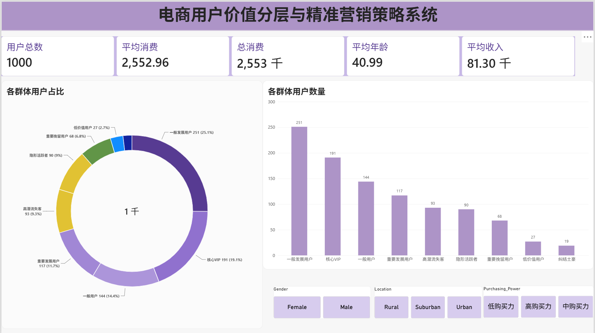
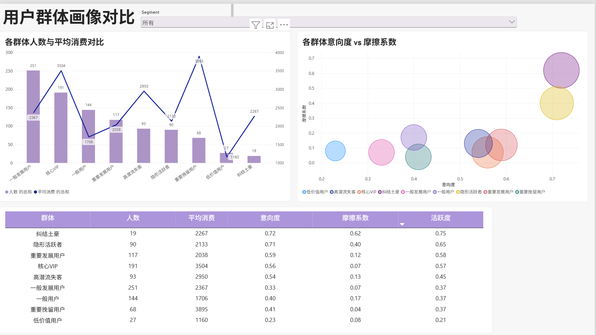
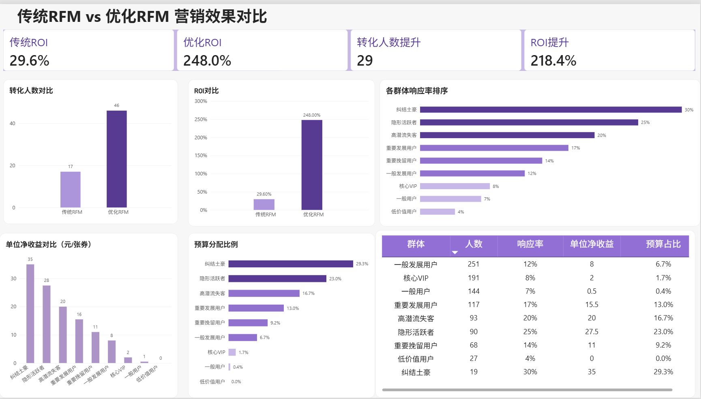

# 电商用户价值分层与精准营销策略系统

##  项目背景
传统 RFM 模型无法识别“高潜观望者”，且忽略购买力背景差异，导致营销预算错配。本项目基于 1000 名电商用户行为数据，改进 RFM 模型，并通过 AB 实验验证了优化策略的业务价值。

##  核心结论
- 在 2000 元同等预算下，传统 RFM 策略 ROI 仅为 **29.6%**，而优化 RFM 策略 ROI 高达 **248.0%**。
- 转化人数提升 **168%**，验证了“把预算投给对的人，比投给贵的人更重要”。
- 识别出“纠结土豪”、“隐形活跃者”等高潜群体，并输出差异化运营策略。

##  核心方法论
在传统 R、F、M 基础上，新增 3 个指标：
1. **意向度**：识别有意愿没行动的用户。
2. **转化摩擦系数**：量化用户纠结程度。
3. **活跃连接度**：区分行为忠诚和名义忠诚。

##  业务看板 (Power BI)

